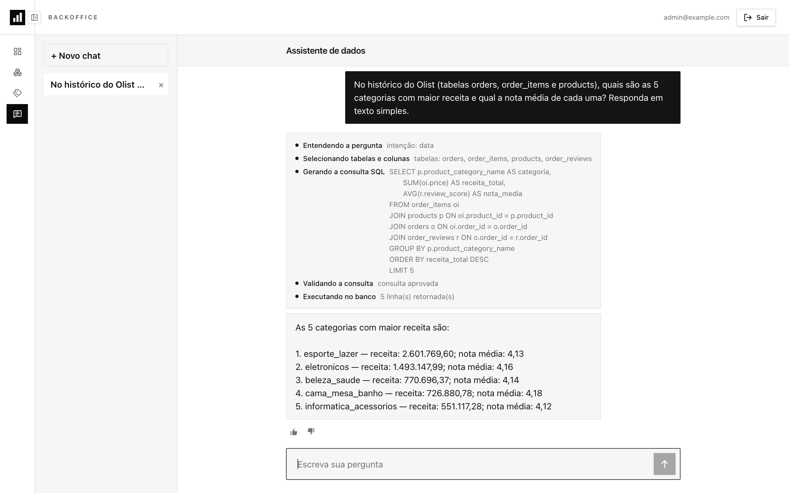
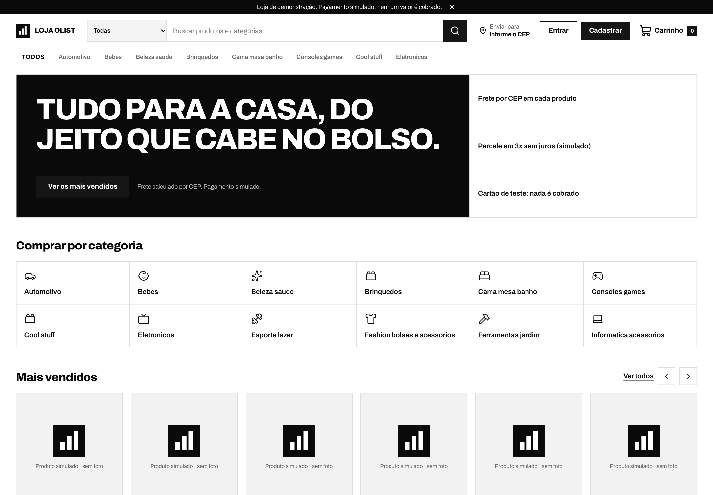
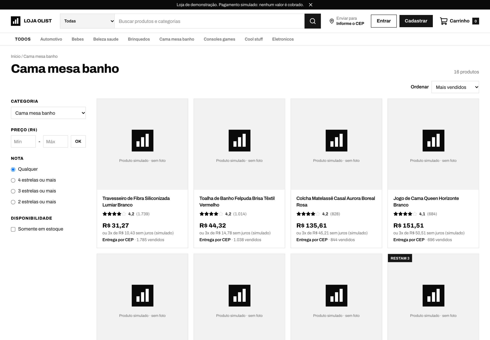
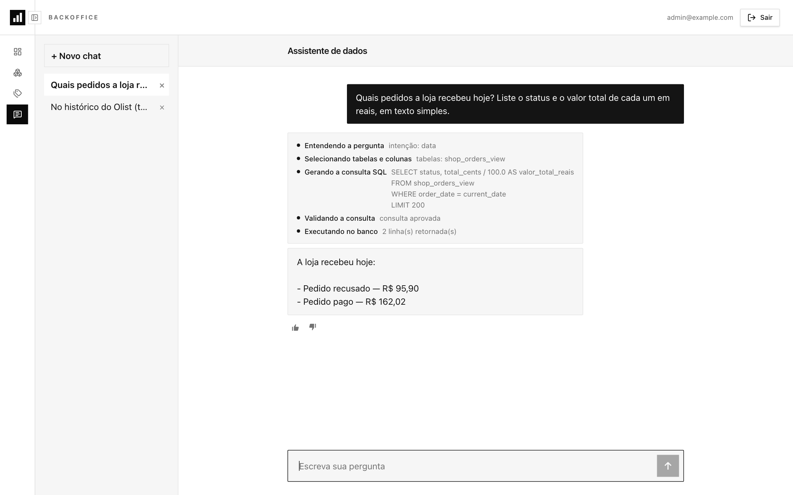

<p align="center">
  
</p>

<h1 align="center">RAG-TEXT-TO-SQL</h1>

<p align="center">
  <strong>Assistente de dados Text-to-SQL: um agente LangGraph que responde perguntas em linguagem natural gerando e executando SQL de forma segura.</strong><br>
  Uma loja online sobre um dataset <a href="https://www.olist.com">Olist</a> enriquecido serve de suporte: gera dados que mudam a cada compra para mostrar como o agente trabalha.
</p>

<p align="center">
  <a href="https://github.com/gustamdev/RAG-Text-to-SQL/actions/workflows/ci.yml"></a>
  <a href="LICENSE"></a>
  
  
  
  
  
  
  
  
</p>

<p align="center">
  <a href="#o-que-o-projeto-mostra">Funcionalidades</a> ·
  <a href="#arquitetura">Arquitetura</a> ·
  <a href="#dataset">Dataset</a> ·
  <a href="#como-rodar">Como rodar</a> ·
  <a href="#api">API</a> ·
  <a href="#segurança">Segurança</a> ·
  <a href="#estrutura">Estrutura</a> ·
  <a href="#licenças">Licenças</a>
</p>

---

O foco do projeto é o **assistente de dados**, um agente Text-to-SQL. A loja online é apenas um suporte: ela gera dados que mudam a cada compra para mostrar a dinâmica do agente e como ele trabalha. Três peças, um backend:

| Peça | Pasta | Papel |
|---|---|---|
| **Assistente de dados** (backoffice) | `frontend-admin/`, só administrador | O assistente de dados, um agente Text-to-SQL que responde perguntas em linguagem natural gerando e executando SQL de forma segura. Ao lado dele, KPIs, produtos e categorias com métricas, pedidos e clientes (com dados pessoais mascarados). |
| **Loja** (suporte) | `frontend/` | catálogo com busca e filtros, carrinho, checkout com pagamento **simulado**, conta do cliente com MFA por e-mail, endereços, frete por CEP, pedidos e direitos do titular (LGPD). |
| **API** | `backend/` | FastAPI em camadas, MongoDB como fonte, DuckDB como snapshot analítico somente leitura. |

**Stack:** Python · FastAPI · LangChain · LangGraph · LangSmith · OpenAI · DuckDB · MongoDB · sqlglot · Pydantic · React · TypeScript · Vite · TanStack Query · Tailwind · shadcn/ui · Recharts · Docker · nginx

> [!NOTE]
> Projeto de portfólio, feito para praticar engenharia de IA e backend com LLM. **Nada é cobrado:** o pagamento é simulado (só cartões de teste) e os dados de clientes, pedidos e produtos são sintéticos.

> [!TIP]
> **Versão só com o assistente.** O projeto começou como apenas o assistente Text-to-SQL. Essa versão original continua na branch [`assistant-only`](https://github.com/gustamdev/RAG-Text-to-SQL/tree/assistant-only). A `main` é o projeto completo.

<p align="center">
  
</p>

## Sumário

- [O que o projeto mostra](#o-que-o-projeto-mostra)
- [Arquitetura](#arquitetura)
- [Dataset](#dataset)
- [Termos técnicos do sistema](#termos-técnicos-do-sistema)
- [Como rodar](#como-rodar)
- [API](#api)
- [Testes e qualidade](#testes-e-qualidade)
- [Decisões e limites](#decisões-e-limites)
- [Segurança](#segurança)
- [Estrutura](#estrutura)
- [Licenças](#licenças)

## O que o projeto mostra

### Agente de dados (LangGraph)

- **Grafo orquestrado:** `StateGraph` com roteamento condicional entre triagem, seleção de schema, geração, validação e execução do SQL. Triagem com few-shot separa conversa comum de perguntas que precisam do banco.
- **Schema linking e catálogo por LLM:** o *prompt optimizer* escolhe só as tabelas e colunas relevantes; cada tabela é descrita uma vez e cacheada.
- **Structured output com Pydantic** em toda etapa do LLM, com pós-processamento determinístico.
- **Guardrails de SQL** (`backend/src/app/sql_guard.py`): AST do `sqlglot`; só `SELECT`/`WITH`, tabelas do catálogo, sem funções perigosas, `LIMIT` garantido. Suíte com ataques (CTE escondendo tabela, `COPY`, `read_csv`, `PRAGMA`, múltiplas instruções).
- **Defesa em profundidade:** DuckDB somente leitura, sem acesso externo, com timeout e limite de concorrência. Tabelas com dados pessoais da loja ficam fora do alcance do agente; ele lê views projetadas sem PII.
- **Self-correction loop** (3 tentativas), **grounding** (a resposta usa só as linhas retornadas) e hierarquia de instruções contra prompt injection.
- **Memória de sessão** (buffer + resumo), **histórico de conversas** por administrador, **streaming SSE** por nó do grafo e **feedback positivo ou negativo** que alimenta um golden dataset.
- **Observabilidade com LangSmith** (opcional, desligada por padrão).

### Loja (suporte ao assistente)

- **Autenticação de duas audiências:** JWT com `aud=shop` ou `aud=admin`, `jti` e `token_version` (revogação no logout); um token nunca vale no outro lado.
- **MFA por e-mail:** OTP de 6 dígitos com HMAC e pepper, expiração, limite de tentativas e de envios (persistidos no Mongo). `MAIL_BACKEND=console` imprime o código no log (dev); em produção exige SMTP.
- **Checkout seguro:** preço, frete e total sempre recalculados no servidor; `Idempotency-Key`; baixa de estoque por decremento condicional atômico (`find_one_and_update` com `$gte` + `$inc`, sem transação); estados do pedido validados no servidor.
- **Pagamento simulado:** só cartões de teste; o número real é descartado, nada de PAN em log ou banco (guarda bandeira e últimos 4 dígitos).
- **Frete por localização:** haversine entre o CEP do depósito e o do cliente, mais peso, offline. Consulta de CEP real opcional (BrasilAPI/ViaCEP) no servidor.
- **LGPD:** exportação e exclusão de conta, textos legais, pseudonimização, PII mascarada no admin, auditoria e retenção. Veja [docs/lgpd-loja.md](docs/lgpd-loja.md) e [docs/seguranca-loja.md](docs/seguranca-loja.md).

<p align="center">
  
  
</p>

A loja é o que mantém os dados vivos: cada compra muda estoque e pedidos, e o agente enxerga a mudança no próximo snapshot do DuckDB (com debounce do serviço). Perguntas sobre os pedidos de hoje refletem o que acabou de acontecer na loja.

<p align="center">
  
</p>

## Arquitetura

```
 Loja (React, nginx :8080) ─┐
                            ├─► FastAPI /api/v1 ──► MongoDB (fonte: Olist, loja, admins, golden dataset)
 Backoffice (React :8081) ──┘        │
                                     └─► DuckDB (snapshot somente leitura: backoffice e agente)
```

### Fluxo do agente

```
START ─► triage ──chat──► chat ──────────────────────────────► END
           │
         data
           ▼
        optimize ◄───────────────── retry_optimize ───┐
           ▼                                          │
      generate_sql ◄──────── retry ──────┐            │
           ▼                             │            │
      validate_sql ──ok──► execute_sql ──┘ (falhou)   │
           │  └── unanswerable ───────────────────────┘
           ▼
        finalize ──► END
```

- **MongoDB** é a fonte: no primeiro start o backend baixa os CSVs e popula as coleções Olist; a loja usa coleções `shop_*` separadas.
- **DuckDB** é um snapshot analítico gerado a partir do Mongo; é onde rodam o SQL do agente e as consultas do backoffice (constantes e parametrizadas, sem LLM).
- **Imagens de produto** ficam num blob storage local (`backend/data/blobstore`), servidas em `/media`.

## Dataset

O seed baixa os CSVs do repositório [Olist-E-Commerce-Public-Dataset-2017-2018](https://github.com/gustamdev/Olist-E-Commerce-Public-Dataset-2017-2018), cuja `main` traz o **dataset enriquecido** que este projeto usa: esquema e distribuições da Olist real, mais produtos nomeados, clientes, pedidos, pagamentos e avaliações sintéticos, cobrindo ~24 meses até 16/11/2026. O recorte original (2017/2018, dados reais) ficou na branch `dataset-original-2017-2018` desse repositório. Detalhes no README dele.

Quem clonar este projeto já recebe a base enriquecida: não há nada para baixar à mão. Para regenerar a base: `cd backend && uv run python scripts/enrich_olist.py --src data/olist --out data/enriched` (precisa do recorte original em `data/olist`).

## Termos técnicos do sistema

| Termo | Onde e como aparece |
|---|---|
| **Text-to-SQL com LangGraph** | `agent_graph.py`: `StateGraph` com nós de triagem, `optimize` (schema linking), `generate_sql`, `validate_sql`, `execute_sql` e `finalize`, com arestas condicionais e laços de retry |
| **Schema linking** | o *prompt optimizer* reescreve a pergunta e seleciona só as tabelas e colunas relevantes antes de gerar o SQL |
| **Structured output** | contratos Pydantic v2 em cada etapa do LLM (`prompts.py`); perfis de modelo por tarefa em `llm_models.py` (LangChain + `langchain-openai`) |
| **Validação por AST** | `sql_guard.py` usa `sqlglot` para aceitar só leitura (`SELECT`/`WITH`), com allowlist de tabelas e `LIMIT` forçado |
| **DuckDB somente leitura** | conexão `read_only=True` com `enable_external_access: False`, timeout e limite de concorrência (`sql_engine.py`) |
| **Snapshot atômico** | o DuckDB é gerado a partir do Mongo num arquivo temporário e trocado com `os.replace` |
| **Views sem PII para o agente** | `shop_views.py`: cliente pseudonimizado (`PSEUDONYM_KEY`), CEP reduzido a 3 dígitos, sem texto livre |
| **Self-correction loop** | erro de validação ou de execução volta ao LLM como feedback, com orçamento de 3 tentativas |
| **SSE** | `GET /chat/questions/{id}/events` via `StreamingResponse`: um evento por nó do grafo |
| **JWT por audiência** | PyJWT; claims `aud` (`shop`/`admin`), `jti`, `tv` comparado com `token_version` do cliente |
| **argon2id** | `argon2-cffi`, com hash descartável para equalizar o tempo de resposta quando o e-mail não existe |
| **OTP com HMAC** | código de 6 dígitos com *pepper* (`OTP_PEPPER`), expiração, limite de tentativas e de envios, índices TTL no Mongo |
| **Idempotência** | cabeçalho `Idempotency-Key` no checkout, com índice único por cliente e hash do corpo |
| **Rate limiting** | `SlidingWindowLimiter` (janela deslizante) e `FailureLimiter` (falhas de login), em memória por processo |
| **Frete haversine** | `services/freight.py`: distância entre prefixos de CEP (tabela `geolocation`) mais peso; CEP real opcional (BrasilAPI/ViaCEP) |
| **LGPD** | exportação (`export`), anonimização na exclusão, `erase_inactive` e rotina de retenção (`shop_retention.py`) |
| **Defesa de borda** | nginx sem root com CSP, `X-Frame-Options` e `nosniff`; `--proxy-headers` com `FORWARDED_ALLOW_IPS` restrito à sub-rede do compose |
| **Build** | Dockerfile multi-stage com `uv` e `uv.lock` (`--frozen`); `pymongo` async; testes com `mongomock-motor` |

## Como rodar

Requisitos: Python 3.13, [uv](https://docs.astral.sh/uv/), Node.js 22, Docker e uma chave da OpenAI (só o assistente precisa dela).

### Desenvolvimento (recomendado)

```bash
git clone https://github.com/gustamdev/RAG-Text-to-SQL.git
cd RAG-Text-to-SQL

# Backend: sobe o MongoDB via docker compose, baixa o dataset, faz o seed e gera o snapshot DuckDB
cd backend
cp .env.example .env     # preencha OPENAI_API_KEY; o resto funciona com o padrão em dev
uv sync
uv run python run.py     # 1º start: baixa a base, popula o Mongo e gera o DuckDB

# Loja (outro terminal)
cd frontend && npm ci && npm run dev          # http://localhost:5173

# Backoffice (outro terminal; reaproveita os node_modules da loja)
cd frontend-admin && ln -s ../frontend/node_modules node_modules && npm run dev   # o Vite mostra a porta
```

> [!IMPORTANT]
> Quando o backend terminar o primeiro start (log "Application startup complete"), rode **uma vez**, em outro terminal, o catálogo da loja. Sem isso a loja fica vazia:

```bash
cd backend && uv run python scripts/seed_shop.py
```

**De onde vem a base:** no primeiro start o backend baixa sozinho os CSVs enriquecidos da `main` do [repo Olist](https://github.com/gustamdev/Olist-E-Commerce-Public-Dataset-2017-2018) (`OLIST_BASE_URL`, já é o padrão) para `backend/data/olist/`, e insere no Mongo. Precisa de internet nessa hora; nas próximas execuções usa o que já está salvo. O seed não roda sobre banco já populado.

A API fica em `http://localhost:8000` (Swagger em `/docs`). Com `MAIL_BACKEND=console`, o código de verificação (OTP) aparece no log do backend.

Não há cadastro público de administrador. Crie um (a senha é pedida no terminal) e entre no backoffice:

```bash
cd backend
uv run python scripts/create_admin.py voce@email.com "Seu Nome"
```

### Tudo em containers

```bash
cp backend/.env.example backend/.env   # edite conforme abaixo
docker compose --profile full up --build
docker compose exec backend python scripts/seed_shop.py      # catálogo da loja (1ª vez, depois do seed automático)
docker compose exec backend python scripts/create_admin.py voce@email.com "Seu Nome"
```

Sobe MongoDB, backend, loja (nginx em `http://localhost:8080`) e backoffice (`http://127.0.0.1:8081`, só localhost). O container roda com `ENV=prod`, então o `backend/.env` precisa de:

| Variável | Para quê |
|---|---|
| `JWT_SECRET`, `OTP_PEPPER`, `PSEUDONYM_KEY` | Segredos, 32+ caracteres cada. Gere com `python -c "import secrets; print(secrets.token_urlsafe(48))"` |
| `MAIL_BACKEND=smtp` + `SMTP_HOST`, `SMTP_FROM`, `SMTP_USER`, `SMTP_PASSWORD` | Envio do OTP (`console` é proibido em prod) |
| `OPENAI_API_KEY` | Assistente de dados |

### Segredos e `.env`

- `backend/.env` **nunca** vai para o Git (ignorado); o repositório só tem o `backend/.env.example`, sem valores reais.
- O `.dockerignore` mantém `.env` e `data/` fora das imagens: segredos entram só em runtime (`env_file` do compose).
- Para ligar o tracing, preencha `LANGSMITH_TRACING=true` e `LANGSMITH_API_KEY`. Com dados reais, mantenha desligado: prompts e linhas de resultado iriam ao LangSmith.

### Dados já carregados

O seed só roda em banco vazio, e `SEED_YEAR` vazio (padrão) carrega todos os anos. Para recarregar do zero: apague o volume do Mongo (`docker compose down -v`) e `backend/data/olist.duckdb`. Fotos CC0 opcionais para os produtos: `uv run python scripts/fetch_images.py` (veja `--dry-run`).

## API

| Área | Rotas (`/api/v1`) | Acesso |
|---|---|---|
| Saúde | `GET /health` | público |
| Catálogo | `GET /shop/products`, `/shop/products/{id}`, `/shop/categories`, `/shop/products/suggest` | público |
| Frete, CEP e textos legais | `GET /shop/products/{id}/freight`, `POST /shop/cart/freight`, `GET /shop/zip/{zip}`, `GET /shop/legal` | público / cliente |
| Conta da loja | `POST /shop/auth/signup`, `/login`, `/verify-otp`, `/resend-otp`, `/logout`, `/reset-password` | público / cliente |
| Carrinho | `GET/POST/PATCH/DELETE /shop/cart/...`, `POST /shop/cart/merge` | cliente |
| Checkout | `POST /shop/checkout`, `/shop/checkout/{id}/pay`, `GET /shop/orders`, `POST /shop/orders/{id}/cancel` | cliente |
| Perfil | `/shop/account/me`, endereços, cartões, exportação e exclusão (LGPD) | cliente |
| Admin | `POST /auth/login`, `GET /auth/me`, `/admin/overview`, `/admin/products`, `/admin/categories`, `/admin/shop/customers`, `/admin/shop/orders` | admin |
| Assistente | `POST /chat/questions`, `GET /chat/questions/{id}/events` (SSE), `POST .../feedback`, `GET/DELETE /chat/threads` | admin |

Contrato completo em [docs/api-loja.md](docs/api-loja.md) e [backend/docs/MAPA_DA_API.md](backend/docs/MAPA_DA_API.md).

## Testes e qualidade

```bash
cd backend       && uv run ruff check . && uv run ruff format --check . && uv run pytest
cd frontend      && npx oxlint && npx tsc -b && npx vitest run && npm run build
cd frontend-admin && npx oxlint && npm test && npm run build
```

Os testes do backend rodam sem OpenAI e sem banco real (LLMs simulados, `mongomock-motor`, DuckDB temporário); os de integração têm o marcador `integration` e não rodam por padrão. O CI (GitHub Actions) roda os três jobs a cada push na `main` e em pull requests.

**Avaliação do agente:** o golden dataset (feedback positivo ou negativo) alimenta `tests/test_golden_regression.py`, que repergunta cada item ao agente real (`-m integration`, precisa de Mongo, DuckDB e `OPENAI_API_KEY`) e imprime a resposta antiga ao lado da nova. Ainda não há avaliador automático de acurácia.

## Decisões e limites

- **sqlglot + DuckDB:** a AST valida o SQL antes de executar (não só bloqueia palavras); o motor restrito é a última barreira.
- **MongoDB como fonte e DuckDB como snapshot:** o Mongo serve a loja (escrita) e o DuckDB a análise (leitura). Para um projeto só de análise, ler os CSVs direto no DuckDB seria mais simples.
- **Backoffice sem LLM:** métricas devem ser determinísticas e baratas; o LLM fica só no assistente.
- **Nota por pedido, não por produto:** a Olist avalia pedidos; o produto herda a nota dos pedidos em que aparece. Cancelados e indisponíveis ficam fora das métricas.
- **Pagamento e e-mail:** pagamento 100% simulado; sem estoque transacional (Mongo standalone, usa operações atômicas por item).
- **Estado em memória:** memória de sessão, resultados do chat e rate limits do catálogo vivem no processo; não escalam para vários workers (em produção iriam para Redis).
- **Planos históricos:** [docs/plano-loja-simulada.md](docs/plano-loja-simulada.md) e [docs/loja-ux.md](docs/loja-ux.md) registram o desenho feito antes da implementação.

## Segurança

- Sem cadastro público de admin; senha em argon2id com tempo de resposta equalizado no login; rate limit de falhas por e-mail e IP.
- Tokens com audiência, `jti` e revogação; papel conferido no banco a cada requisição; chat e backoffice só para administrador, com limite de perguntas (custo de LLM).
- SQL do agente: validador por AST, allowlist, motor somente leitura, timeout e limite de linhas. SQL do backoffice: placeholders e ordenação por allowlist.
- Corpos de entrada rejeitam campos desconhecidos; o cliente nunca envia preço, total, frete ou estado do pedido.
- Rotas públicas com limite por IP, CORS com lista explícita de métodos e cabeçalhos, cabeçalhos de segurança no nginx (CSP, `X-Frame-Options`, `nosniff`); só o nginx da rede do compose pode informar o IP do cliente.
- Segredos só no `.env`; com `ENV=prod` o backend recusa segredos curtos e `MAIL_BACKEND=console`.

### Limites conhecidos

- O MongoDB do compose não tem autenticação e só escuta em `127.0.0.1`; em produção use credenciais e rede privada.
- O JWT fica em `localStorage` (12 h); o ideal em produção é cookie `HttpOnly` com token curto e refresh.
- O assistente envia até 50 linhas de resultado à OpenAI; os dados deste projeto são sintéticos, mas com dados reais seria preciso mascarar antes (veja a análise LGPD).
- O backoffice deve ficar atrás de VPN ou allowlist de IP em produção.

## Estrutura

```
backend/
  src/app/
    agent_graph.py   grafo do agente (LangGraph)
    prompts.py       templates e contratos dos prompts
    sql_guard.py     validador de SQL somente leitura (AST do sqlglot)
    api/routes/      health, auth, catálogo, backoffice, chat, shop_* (loja), admin_shop, media
    auth/            senha (argon2id) e JWT com audiência
    services/        catálogo, carrinho, checkout, pagamento, frete, e-mail, memória, agente, LGPD
    database/        Mongo, seed, snapshot DuckDB, views sem PII, repositórios, índices
  scripts/           create_admin, seed_shop, enrich_olist, enrich_catalog, fetch_images
  tests/             pytest
frontend/            loja (React + Vite + nginx)
frontend-admin/      backoffice e assistente (reusa components/ui e lib da loja)
docs/                API da loja, LGPD, segurança, UX e planos
docker-compose.yml   MongoDB (perfil "full": backend, loja e backoffice)
```

## Licenças

Código: [MIT](LICENSE). Dados: [Olist](https://www.olist.com), publicados no [Kaggle](https://www.kaggle.com/datasets/olistbr/brazilian-ecommerce) sob a licença [CC BY-NC-SA 4.0](https://creativecommons.org/licenses/by-nc-sa/4.0/). O dataset enriquecido usado aqui é uma obra derivada e mantém essa licença (uso não comercial): [Olist-E-Commerce-Public-Dataset-2017-2018](https://github.com/gustamdev/Olist-E-Commerce-Public-Dataset-2017-2018).
